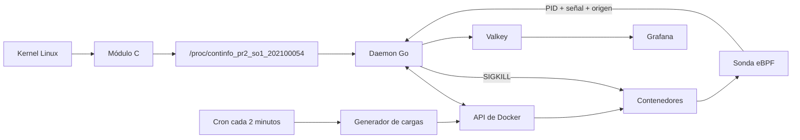

# Proyecto 2 — Observabilidad y gestión autónoma de contenedores

Sistema integral de telemetría, auditoría y administración automática de
contenedores para Sistemas Operativos 1.

**Estudiante:** Victor Hugo Velásquez Hernández  
**Carné:** 202100054

## Estado

El proyecto integra:

- Módulo del kernel en C con la interfaz
  `/proc/continfo_pr2_so1_202100054`.
- Daemon en Go con ciclos configurables entre 20 y 60 segundos.
- Política que conserva 3 contenedores `low` y 2 `high`.
- Reposición automática de contenedores faltantes.
- Sonda eBPF para auditar señales de terminación.
- Confirmación eBPF antes de registrar `container_deleted`.
- Cronjob que genera 5 contenedores aleatorios cada 2 minutos.
- Valkey como almacenamiento histórico.
- Dashboard de Grafana provisionado como código.

## Arquitectura



### Eliminación confirmada

1. El daemon obtiene del módulo la telemetría del contenedor.
2. La política selecciona una carga no protegida.
3. `deletionTracker` registra el PID esperado.
4. El daemon solicita `SIGKILL` mediante la API de Docker.
5. eBPF observa el evento real del kernel.
6. El daemon valida el PID objetivo, la señal 9 y el origen
   `signal_generate`.
7. Docker retira definitivamente el contenedor.
8. Solo entonces se escribe `container_deleted` en Valkey.

Una señal que no coincida con el PID esperado no se registra como una
eliminación confirmada.

## Estructura

```text
proyecto2/
├── cron/                       # instalación y retiro del cronjob
├── daemon/
│   ├── cmd/daemon/             # servicio principal
│   ├── cmd/ebpf-test/          # prueba aislada de eBPF
│   └── internal/               # política, Docker, eBPF, Valkey
├── kernel/                     # módulo C y Makefile
├── monitoring/
│   ├── compose.yaml            # Valkey y Grafana
│   ├── dashboards/             # dashboard como JSON
│   └── provisioning/           # datasource y provider
├── scripts/check_environment.sh
└── workloads/
    ├── intruder/               # imagen intrusa controlada
    └── scripts/generate_containers.sh
```

## Requisitos

Los componentes deben ejecutarse en la misma máquina Linux: `/proc`, los
procesos de Docker y los eventos eBPF pertenecen al kernel del anfitrión.

- Ubuntu 24.04 o Linux compatible, preferiblemente `x86_64`.
- Headers correspondientes al kernel activo.
- GCC, Make, Clang, LLVM, `bpftool`, BTF y cgroup v2.
- Go 1.22.2 o superior.
- Docker Engine y Docker Compose.
- `cron`, `jq`, `curl`, `redis-cli`, OpenSSL y `mokutil`.
- Acceso a `sudo`.
- Puertos locales 3000 y 6379 disponibles.

## Instalación desde cero

### 1. Paquetes base

```bash
sudo apt update
```

```bash
sudo apt install -y \
  build-essential \
  linux-headers-"$(uname -r)" \
  clang llvm \
  linux-tools-common linux-tools-"$(uname -r)" \
  libbpf-dev \
  golang-go cron jq curl redis-tools \
  openssl mokutil
```

Docker Engine y Compose deben instalarse desde una sola fuente. Si la máquina ya
usa Docker CE, no se debe instalar `docker.io` encima.

Confirmar que `bpftool` quedó disponible:

```bash
bpftool version
```

Si se utiliza un kernel personalizado y Ubuntu no publica
`linux-tools-$(uname -r)`, `bpftool` debe instalarse mediante los paquetes o
el procedimiento correspondiente a la fuente de ese kernel.

```bash
docker --version
```

```bash
docker compose version
```

```bash
sudo systemctl enable --now docker cron
```

Para utilizar Docker con el usuario actual:

```bash
sudo usermod -aG docker "$USER"
```

Después hay que cerrar la sesión y volver a entrar. El grupo `docker` concede
privilegios equivalentes a `root`.

### 2. Repositorio y diagnóstico

```bash
git clone <URL_DEL_REPOSITORIO>
```

```bash
cd <CARPETA_DEL_REPOSITORIO>/proyecto2
```

```bash
bash scripts/check_environment.sh
```

No deben quedar resultados `FAIL` relacionados con Docker, Go, headers,
Clang/LLVM, `bpftool` o BTF.

```bash
docker compose -f monitoring/compose.yaml config --quiet
```

```bash
jq empty monitoring/dashboards/proyecto2-observabilidad.json
```

### 3. Firma del módulo y Secure Boot

El Makefile siempre firma el módulo antes de cargarlo y espera:

```text
/var/lib/shim-signed/mok/MOK.priv
/var/lib/shim-signed/mok/MOK.der
```

Comprobar primero si ya existen:

```bash
sudo test -f /var/lib/shim-signed/mok/MOK.priv \
  && sudo test -f /var/lib/shim-signed/mok/MOK.der \
  && echo "Claves MOK existentes"
```

Si existen, no deben regenerarse. Si faltan, se crean una sola vez:

```bash
sudo mkdir -p /var/lib/shim-signed/mok
```

```bash
sudo openssl req -new -x509 -newkey rsa:2048 \
  -keyout /var/lib/shim-signed/mok/MOK.priv \
  -outform DER \
  -out /var/lib/shim-signed/mok/MOK.der \
  -nodes -days 36500 \
  -subj '/CN=SO1 Proyecto 2/'
```

```bash
sudo chmod 600 /var/lib/shim-signed/mok/MOK.priv
```

```bash
mokutil --sb-state
```

Si Secure Boot está habilitado:

```bash
sudo mokutil --import /var/lib/shim-signed/mok/MOK.der
```

Después se reinicia el equipo y se selecciona **Enroll MOK**. No se debe
sobrescribir una clave que ya fue enrolada.

Después del reinicio puede revisarse la lista de certificados:

```bash
mokutil --list-enrolled
```

Aunque Secure Boot esté deshabilitado, el Makefile actual requiere ambos
archivos MOK porque siempre firma el módulo antes de cargarlo; únicamente el
enrolamiento es condicional.

### 4. Imágenes de trabajo

```bash
docker pull alpine:latest
```

```bash
docker pull roldyoran/go-client:latest
```

```bash
docker build -t so1-intruder:202100054 workloads/intruder
```

```bash
docker image inspect \
  alpine:latest \
  roldyoran/go-client:latest \
  so1-intruder:202100054 >/dev/null
```

### 5. Compilar y probar el daemon

Se compila como usuario normal, no mediante `sudo go run`:

```bash
cd daemon
```

```bash
GOCACHE=/tmp/proyecto2-go-build-cache go mod download
```

```bash
GOCACHE=/tmp/proyecto2-go-build-cache go test ./...
```

```bash
GOCACHE=/tmp/proyecto2-go-build-cache go test -race ./...
```

```bash
GOCACHE=/tmp/proyecto2-go-build-cache go vet ./...
```

```bash
GOCACHE=/tmp/proyecto2-go-build-cache \
  go build -o daemon ./cmd/daemon
```

## Levantar todo de una vez

Este es el procedimiento recomendado para la calificación. El daemon administra
el ciclo completo:

```text
Docker Compose → módulo firmado → cronjob → eBPF → ciclos del daemon
```

### 1. Precomprobación

Desde `proyecto2/daemon`:

```bash
pgrep -af 'proyecto2/daemon|cmd/daemon'
```

```bash
make -C ../kernel status
```

```bash
crontab -l 2>/dev/null \
  | grep SO1_PROYECTO2_202100054 || true
```

No debe existir otra instancia. Si un daemon está activo, se detiene con
`Ctrl+C` en su terminal; no se descarga el módulo debajo de un daemon vivo.

Si no existe un daemon pero quedaron recursos huérfanos:

```bash
bash ../cron/remove_cron.sh
```

```bash
make -C ../kernel unload
```

### 2. Único comando de arranque

```bash
sudo ./daemon \
  -project-root=.. \
  -interval=30s \
  -top=5 \
  -execute
```

La terminal debe permanecer abierta durante toda la calificación. La salida
correcta incluye:

```text
Iniciando infraestructura de monitoreo...
Cargando módulo del kernel...
Instalando cronjob del proyecto...
Monitor eBPF conectado con Valkey
Daemon periódico iniciado: intervalo=30s
```

Aunque el daemon se ejecute con `sudo`, valida `SUDO_USER` y ejecuta los
scripts del cron bajo ese usuario. Por eso el comando solicitado por la guía
funciona literalmente:

```bash
crontab -l
```

Si el binario se inicia directamente desde una sesión `root`, el fallback es
el crontab de `root` y se consulta con `sudo crontab -l`.

Opciones importantes:

| Opción | Predeterminado | Función |
|---|---:|---|
| `-project-root` | `..` | Ruta de la carpeta `proyecto2`. |
| `-interval` | `30s` | Intervalo; acepta 20–60 segundos o 0 para un ciclo. |
| `-top` | `5` | Procesos mostrados por consumo de CPU. |
| `-low-target` | `3` | Objetivo de cargas de bajo consumo. |
| `-high-target` | `2` | Objetivo de cargas de alto consumo. |
| `-execute` | `false` | Aplica las eliminaciones de la política. |
| `-ebpf` | `true` | Activa la auditoría eBPF. |
| `-manage-lifecycle` | `true` | Administra Compose, módulo y cron. |

Para la demostración debe utilizarse `-execute`.

## Prueba según la guía de calificación

Antes de la vuelta 1, el comando de arranque anterior debe seguir ejecutándose.
Las pruebas se realizan en una segunda terminal.

```bash
cd <CARPETA_DEL_REPOSITORIO>/proyecto2
```

### Vuelta 1 — módulo del kernel

Comando solicitado:

```bash
lsmod | grep continfo_pr2_so1_202100054
```

```bash
cat /proc/continfo_pr2_so1_202100054
```

El módulo debe aparecer y el segundo comando debe mostrar JSON legible con RAM
total, libre y usada, además de PID, nombre, VSZ, RSS, memoria y CPU.

Validación adicional:

```bash
make -C kernel validate
```

### Vuelta 2 — datos, cronjob y restricciones

```bash
docker ps --format "table {{.ID}}\t{{.Names}}\t{{.Status}}"
```

Los PID del archivo `/proc` deben corresponder con contenedores reales. Para
comparar un PID:

```bash
docker inspect \
  --format '{{.State.Pid}} {{.Id}} {{.Name}}' \
  "$(docker ps -q | head -n 1)"
```

La guía indica:

```bash
crontab -l
```

```bash
docker ps
```

El cronjob debe contener la marca `SO1_PROYECTO2_202100054`. Para generar las
cargas inmediatamente, sin esperar dos minutos:

```bash
sudo bash workloads/scripts/generate_containers.sh
```

Después de uno o dos ciclos:

```bash
docker ps \
  --filter label=so1.project=proyecto2 \
  --filter label=so1.tier=low \
  --format '{{.ID}}' | wc -l
```

Resultado esperado: `3`.

```bash
docker ps \
  --filter label=so1.project=proyecto2 \
  --filter label=so1.tier=high \
  --format '{{.ID}}' | wc -l
```

Resultado esperado: `2`.

Grafana y Valkey deben permanecer protegidos:

```bash
docker inspect so1-grafana so1-valkey \
  --format '{{.Name}} protected={{index .Config.Labels "so1.protected"}} running={{.State.Running}}'
```

### Vuelta 3 — daemon y Valkey

```bash
ps aux | grep '[d]aemon'
```

```bash
redis-cli -h localhost -p 6379 KEYS '*'
```

```bash
redis-cli -h localhost -p 6379 \
  GET so1:proyecto2:telemetry:latest
```

El proceso debe estar vivo y la clave debe contener JSON válido, no vacío.

Claves utilizadas:

| Clave | Contenido |
|---|---|
| `so1:proyecto2:telemetry:latest` | Última telemetría. |
| `so1:proyecto2:telemetry:history` | Historial de telemetría. |
| `so1:proyecto2:ebpf:latest` | Último evento eBPF relevante. |
| `so1:proyecto2:ebpf:history` | Historial de eventos eBPF. |
| `so1:proyecto2:containers:deleted:latest` | Última eliminación confirmada. |
| `so1:proyecto2:containers:deleted:history` | Historial de eliminaciones. |

Si `redis-cli` no está instalado en el anfitrión, la consulta equivalente es:

```bash
docker exec so1-valkey valkey-cli \
  GET so1:proyecto2:telemetry:latest
```

### Vuelta 4 — eBPF

No se debe ejecutar `docker kill` directamente: una señal ajena a la decisión
del daemon no está registrada en `deletionTracker` y correctamente no se
acepta como eliminación confirmada.

Para provocar una eliminación real y determinista de la política, crear un
intruso controlado desde la carpeta `proyecto2`. Se usa un nombre único para
que la prueba pueda repetirse:

```bash
evaluation_name="so1-evaluacion-intruder-$(date +%s)"
```

```bash
docker run -d \
  --name "$evaluation_name" \
  --label so1.project=proyecto2 \
  --label so1.carnet=202100054 \
  --label so1.profile=intruder \
  --label so1.tier=intruder \
  --label so1.protected=false \
  --memory 64m \
  --cpus 0.10 \
  --mount \
    type=bind,src="$PWD/workloads/intruder/decoy/sensitive.txt",dst=/host-sensitive/sensitive.txt,readonly \
  so1-intruder:202100054
```

Observar la primera terminal durante el siguiente ciclo. Debe aparecer un evento
reciente con origen, PID emisor, PID objetivo y señal 9, seguido por la
eliminación confirmada.

```bash
redis-cli -h localhost -p 6379 \
  GET so1:proyecto2:containers:deleted:latest
```

```bash
redis-cli -h localhost -p 6379 \
  LRANGE so1:proyecto2:containers:deleted:history 0 4
```

El registro debe tener `status=container_deleted`, `signal=9`,
`event_source=signal_generate` y el mismo valor en `container_pid` y
`target_pid`. Sin confirmación eBPF no se guarda `container_deleted`.

### Vuelta 5 — Grafana

Abrir:

<http://127.0.0.1:3000/d/so1-proyecto2-observabilidad/91ba53d>

Credenciales predeterminadas:

```text
Usuario: admin
Contraseña: so1-202100054
```

Comprobar antes:

```bash
docker compose -f monitoring/compose.yaml ps
```

```bash
curl -fsS http://127.0.0.1:3000/api/health | jq
```

El dashboard muestra RAM total/usada/libre, evolución de RAM, eliminaciones en el
tiempo, Top 5 RAM/CPU incluyendo eliminados y auditoría eBPF.

### Vuelta 6 — documentación

Este documento explica la arquitectura, instalación, ejecución, pruebas y
decisiones de seguridad. Para la defensa conviene poder explicar:

- Cómo el módulo recorre procesos y calcula memoria/CPU.
- Por qué el daemon usa la API de Docker para enviar `SIGKILL`.
- Cómo se correlaciona el PID con eBPF.
- Por qué una señal no confirmada no se almacena como eliminación.
- Cómo se protege Grafana y Valkey.
- Por qué el sistema conserva 3 contenedores `low` y 2 `high`.

La actividad de un módulo en Rust es adicional y no forma parte de esta
implementación.

## Parada segura

Presionar `Ctrl+C` en la primera terminal. El daemon:

1. Detiene eBPF.
2. Elimina el cronjob del mismo usuario que lo instaló.
3. Descarga el módulo.

Grafana y Valkey permanecen activos para conservar los datos.

```bash
crontab -l 2>/dev/null \
  | grep SO1_PROYECTO2_202100054 || true
```

```bash
make -C kernel status
```

Detener el monitoreo conservando los volúmenes:

```bash
docker compose -f monitoring/compose.yaml stop
```

Reanudarlo:

```bash
docker compose -f monitoring/compose.yaml start
```

No se debe usar `docker compose down -v` durante las pruebas: `-v` elimina
los volúmenes persistentes de Grafana y Valkey.

## Diagnóstico manual

Este modo no debe mezclarse con el ciclo administrado:

```bash
docker compose -f monitoring/compose.yaml up -d --wait
```

```bash
make -C kernel load
```

```bash
bash cron/install_cron.sh
```

```bash
cd daemon
sudo ./daemon -project-root=.. \
  -manage-lifecycle=false -interval=30s -execute
```

En este modo la limpieza también es manual:

```bash
bash ../cron/remove_cron.sh
```

```bash
make -C ../kernel unload
```

## Regeneración opcional de eBPF

Los artefactos generados necesarios ya están versionados. Solo después de
modificar `kill_monitor.bpf.c`:

```bash
cd <CARPETA_DEL_REPOSITORIO>/proyecto2
```

```bash
bpftool btf dump file /sys/kernel/btf/vmlinux format c \
  > daemon/internal/ebpfwatcher/bpf/vmlinux.h
```

```bash
cd daemon
go generate ./internal/ebpfwatcher
```

`vmlinux.h` es local e ignorado por Git.

## Problemas frecuentes

Los comandos de esta sección parten desde la carpeta `proyecto2`:

```bash
cd <CARPETA_DEL_REPOSITORIO>/proyecto2
```

### Docker devuelve `permission denied`

```bash
sudo systemctl status docker
id -nG
```

### El módulo ya está cargado

No iniciar una segunda instancia. Primero:

```bash
pgrep -af 'proyecto2/daemon|cmd/daemon'
```

Si no hay daemon, retirar el módulo huérfano:

```bash
make -C kernel unload
```

### El cronjob no puede escribir `logs/cron.log`

Puede ocurrir después de una ejecución antigua que instaló el cron como
`root`. Si no hay otro daemon ejecutándose, devolver la carpeta al usuario:

```bash
sudo chown -R "$USER":"$(id -gn)" logs
```

Después se puede iniciar nuevamente el daemon administrado.

### `Required key not available`

El certificado no está enrolado en Secure Boot:

```bash
mokutil --sb-state
```

### eBPF no inicia

```bash
test -r /sys/kernel/btf/vmlinux
sudo bpftool feature probe kernel
```

### Grafana no tiene datos

```bash
docker compose -f monitoring/compose.yaml ps
docker compose -f monitoring/compose.yaml logs --tail=100 grafana
docker exec so1-valkey valkey-cli \
  GET so1:proyecto2:telemetry:latest
```

## Seguridad y entrega

- Solo se administran contenedores con `so1.project=proyecto2`.
- `so1.protected=true` impide eliminar Grafana y Valkey.
- Los puertos 3000 y 6379 solo se publican en `127.0.0.1`.
- La imagen intrusa usa un archivo señuelo de solo lectura.
- No se publican claves privadas MOK, archivos `.env` ni datos sensibles.
- Deben conservarse evidencias de `/proc`, cron, política 3/2, eBPF, Valkey y
  Grafana.
- El repositorio privado debe incluir como colaboradores a
  `@JoseLorenzana272` y `@KINGR0X`.
- Antes de entregar se recomienda repetir el procedimiento desde un clon limpio.
